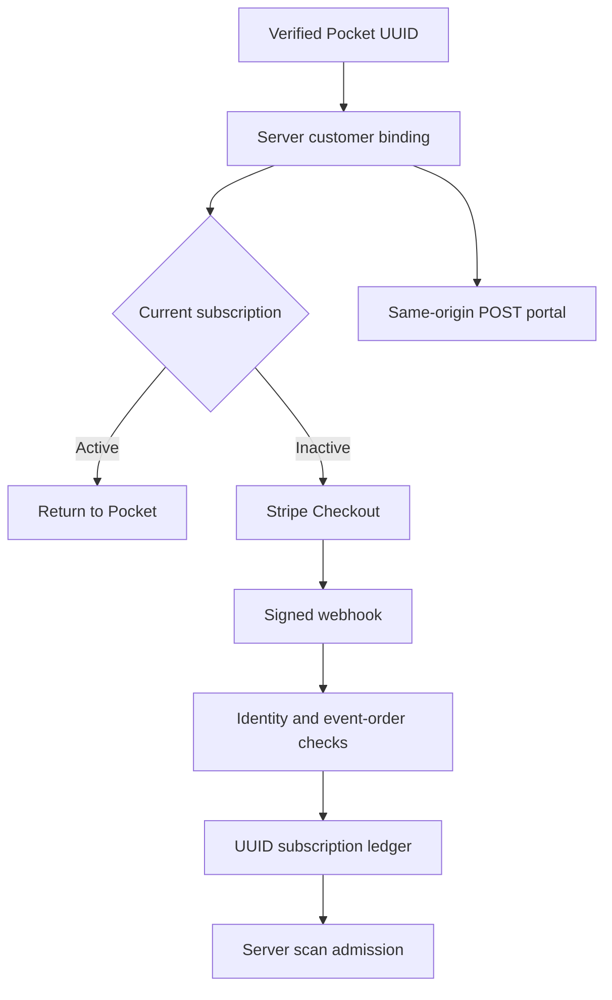
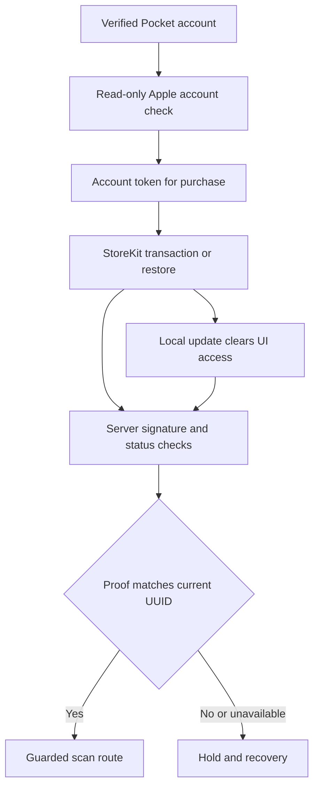

# Customer path contracts — Monaco126

Source: core614371532b19814f8c1ac8bc8e8aed9b10f5ae0f. These describe implemented guarded code, not completed live or signed-device acceptance. Existing owner Sitesv179 paid admission is retained historical evidence. Source/mock contract tests and actual store transactions are separate.

## Web account and billing

Customer selection comes from the durable UUID mapping, never a client ID or email discovery. An active/unknown membership cannot begin a new candidate checkout; this is not a global concurrent-checkout uniqueness claim. The portal permits expired customers to manage billing and redirects only to billing.stripe.com. A metadata-less legacy renewal uses the existing exact subscription/customer pair; malformed asserted ownership is rejected. The proposed SQL successor fixes a reproduced mutable-FOUND guard defect but remains uninstalled.

## Apple proof and account ownership

The native UI shows Restore/Retry when initialization or server verification fails. Pending/unmarked/error events cannot show a purchase offer. Every billed route rechecks verified identity and server entitlement; local StoreKit flags and first-free preferences cannot grant it. A valid independent Apple proof can admit during web-ledger outage; no first-free fallback follows an outage. First-free remains OFF.

Source contracts: tests/pocket-billing-portal.test.ts, pocket-checkout-customer.test.ts, pocket-legacy-renewal.test.ts, pocket-native-subscription-recovery.test.ts and the existing Apple/access suites. No Stripe session, StoreKit purchase, refund or customer mutation occurred in this programme. The new Node/native pin and Sites runtime require separate exact-source/environment acceptance.
